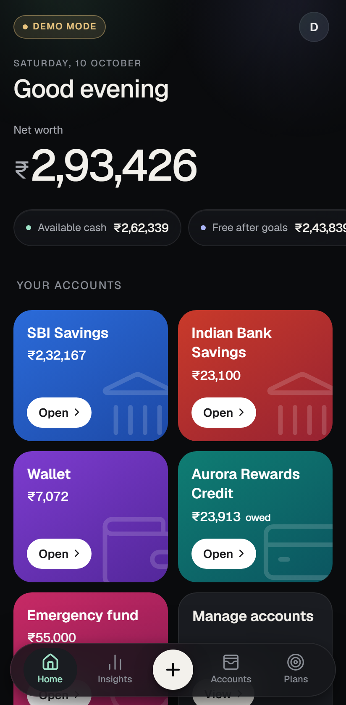
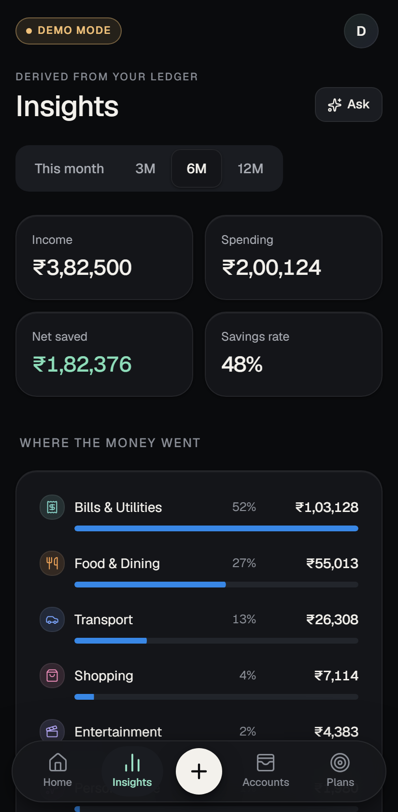
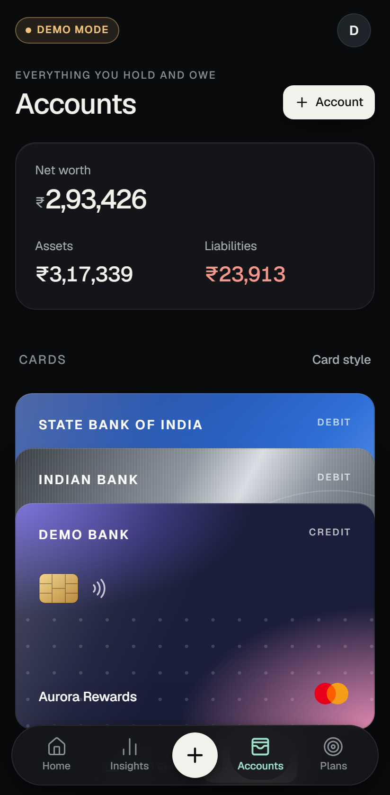
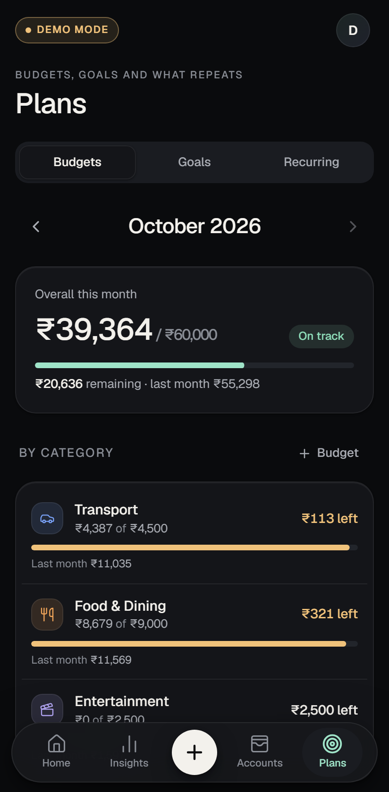
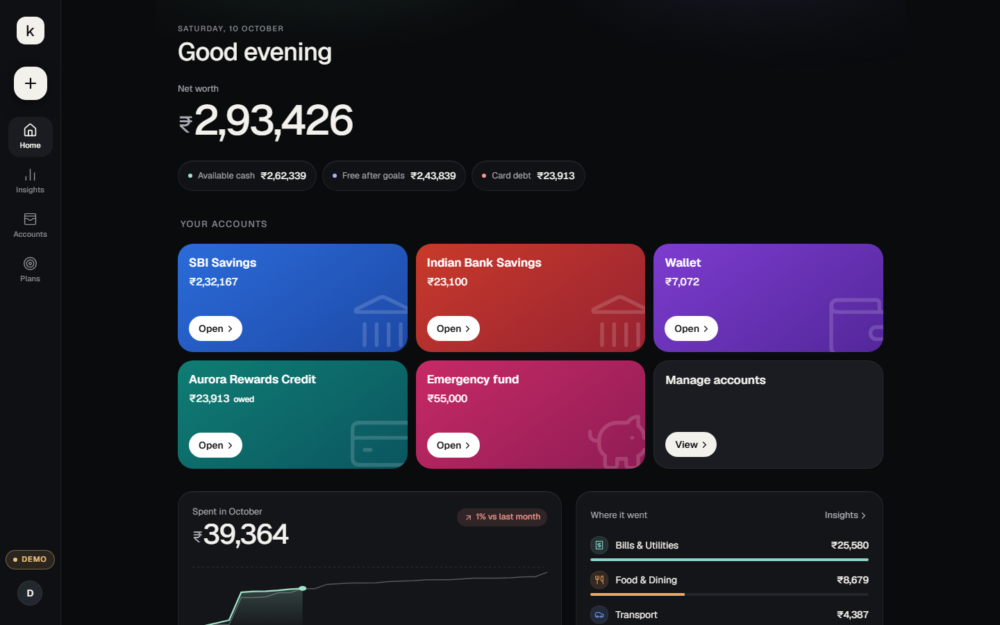

# Kosh

A calm, exact personal finance tracker for one person in India (INR, Asia/Kolkata). Every number
comes from one double-entry ledger, adding an expense takes an amount and one tap, and it runs as a
web app, an installable PWA, and a native Android app.

<p align="center">
  
  
  
  
</p>

<p align="center"></p>

<sub>Screenshots are from Demo Mode, which uses fictional data.</sub>

**Try it on Android:** download the Demo build from [Releases](https://github.com/VivaanN98/Kosh/releases). It runs on fictional data with no setup. To track real money, self-host (below).

## What it does

- **Ledger:** expenses, income, transfers, card payments, refunds, reconciliation adjustments and
  goal transfers. Each is a transaction with balanced ledger entries; nothing is double-counted.
- **Accounts:** cash, bank, credit cards (statement balance vs current debt, minimum due, payments
  since statement), goal pots, archiving and reconciliation.
- **Plans:** monthly budgets (overall and per category) with warnings and overspend alerts; savings
  goals (earmark or separate pot); recurring rules (remind or auto-record, end-of-month safe,
  never duplicated); and subscriptions.
- **Insights:** category breakdown, monthly comparison, cash flow, savings rate and spending trend,
  all derived from the ledger. Plus **Ask Kosh**, a read-only AI assistant (needs a key).
- **Cards:** three wallet styles (Stacked, Orbit, Vertical Carousel) chosen in Settings, plus manual
  add or camera scan with on-device OCR. Card numbers, CVV and photos are never stored.
- **Data:** CSV export, Demo Mode with fictional data, Supabase Auth with row-level security.

## Quick start (local)

Requirements: Node 22, Docker Desktop running.

```bash
npm install
npm run db:start                    # local Supabase in Docker (first run downloads images)
npm run db:reset                    # apply migrations
node scripts/write-local-env.mjs    # writes .env.local for the local stack
npm run dev                         # http://localhost:5173
```

Create an account on the sign-in screen (local Supabase needs no email confirmation), or choose
**Explore Demo Mode**. On your phone: `npm run dev:phone` prints an `https://…trycloudflare.com` link.

## Commands

| Task | Command |
| --- | --- |
| Dev server | `npm run dev` |
| Dev on phone (https tunnel) | `npm run dev:phone` |
| Production build / serve | `npm run build` / `npm start` |
| Unit + adapter tests | `npm test` |
| Database tests (local Supabase) | `npm run test:db` |
| End-to-end tests | `npm run test:e2e` |
| Lint / type-check | `npm run lint` / `npm run typecheck` |
| Migrations | `npm run db:reset` (rebuild) · `npm run db:migrate` (new only) |
| Android APK | `npm run android:apk` → `dist-apk/Kosh-<version>.apk` |
| App icons | `npm run icons` |
| OCR engine comparison | `npm run ocr:eval` |

## Documentation

- [Architecture](docs/architecture.md): layers, the ledger, data adapters, client store.
- [Database](docs/database.md): tables, RPC functions, RLS, CSV export fields.
- [Security & privacy](docs/security.md): what is stored, what never is, the assistant's limits.
- [Deployment](docs/deployment.md): cloud Supabase, the Android app, PWA hosting, the assistant key.
- [Testing](docs/testing.md): suites, what they prove, performance numbers.
- [OCR evaluation](docs/ocr.md): how the card-scanning engine was chosen.

## Self-hosting, contributing, license

Kosh has no hosted service: you run your own Supabase project (free tier is enough) and keep your own
data and keys. Demo Mode needs nothing and keeps fictional data on the device. Setup is in
[Deployment](docs/deployment.md). Please read [CONTRIBUTING.md](CONTRIBUTING.md) before opening a pull
request and [SECURITY.md](SECURITY.md) before reporting a vulnerability.

Released under the [MIT License](LICENSE).
